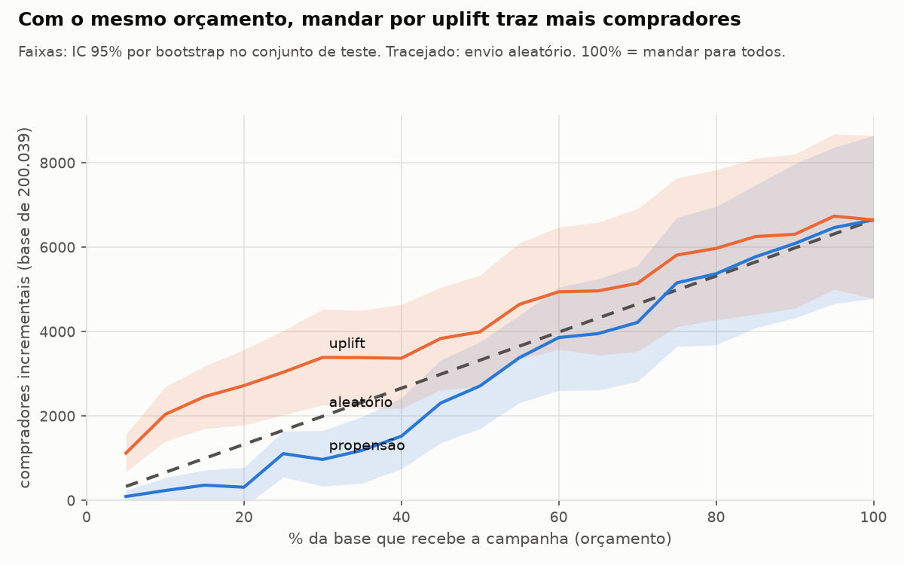

# Quem deve receber a campanha?

Um varejista mandou uma comunicação para metade de 200 mil clientes, sorteados. Este projeto
lê esse experimento direito, descobre em quem a campanha muda o comportamento e transforma
isso numa decisão de orçamento. Os dados são reais (X5 RetailHero, 45,8 milhões de itens
comprados), o perfil dos clientes é construído em SQL e o resultado sai em rublos.



## O resultado

| pergunta | resposta |
|---|---|
| A campanha funciona? | Sim, pouco: a taxa de compra vai de 60,3% para 63,7%, **+3,3 p.p.** (IC 95% 2,9 a 3,7). |
| Para quem ela funciona? | Quem gasta pouco, compra pouco e está há mais dias sem comprar. No decil que menos gasta o efeito é **+7,2 p.p.**; no que mais gasta, perto de 1 p.p. |
| Mandar para os "melhores clientes" funciona? | Não. Um modelo de propensão põe no topo quem compraria 95% das vezes sem campanha; nos 30% que ele escolhe o efeito é de 1,6 p.p., **abaixo do envio aleatório**. |
| E um modelo de uplift? | Nos 30% de maior score o efeito é **5,6 p.p.**, e esses 30% já concentram metade dos compradores incrementais. |
| Quanto vale? | Com ₽ 3 por contato e margem de 20%: mandar por uplift para 30% da base dá **₽ 156 mil** de lucro incremental, contra ₽ 59 mil mandando para todos, com 70% menos contatos. |

A recomendação, os números e os riscos para o gerente de CRM estão no
**[memorando de uma página](docs/memorando.md)**. O **simulador** (Streamlit) deixa mudar custo,
ticket, margem e orçamento: `uv run --extra app streamlit run app/streamlit_app.py`.

## Como foi feito

| etapa | onde | o que sai |
|---|---|---|
| 1. Auditoria em SQL | [`sql/00_auditoria/`](sql/00_auditoria) | [`reports/auditoria.md`](reports/auditoria.md): chaves, datas, valores e distribuições, cada problema contado |
| 2. Perfil do cliente em SQL | [`sql/10_perfil_cliente/`](sql/10_perfil_cliente) | 36 variáveis por cliente (recência com `LAG`, gasto em janelas com `FILTER`, tendência em meses móveis, decis com `NTILE`), tudo antes da data de corte |
| 3. Placar do experimento | [`sql/20_placar_experimento/`](sql/20_placar_experimento) + [`stats.py`](src/persuadables/stats.py) | [`reports/placar.md`](reports/placar.md): sorteio (SRM), balanço (SMD), efeito com IC analítico e bootstrap, CUPED, poder, segmentos com Benjamini-Hochberg |
| 4. Uplift | [`uplift.py`](src/persuadables/uplift.py) | [`reports/uplift.md`](reports/uplift.md): propensão contra S-, T-, X-learner e class transformation, com Qini, AUUC e perfil de quem é influenciado |
| 5. Decisão | [`decisao.py`](src/persuadables/decisao.py) | [`reports/decisao.md`](reports/decisao.md): compradores incrementais e lucro por orçamento, com IC e sensibilidade às premissas |
| 6. Escala | [`sql/30_escala_criteo/`](sql/30_escala_criteo) | [`reports/escala_criteo.md`](reports/escala_criteo.md): o mesmo placar em 14 milhões de linhas |

Decisões de projeto em [`docs/adr/`](docs/adr): data de corte, desfecho e métrica de proteção,
por que DuckDB, grão da transação.

### Placar dos modelos (conjunto de teste, 40 mil clientes)

| modelo | AUUC | Qini | efeito nos 30% de maior score | fatia dos incrementais nos 30% |
|---|---:|---:|---:|---:|
| X-learner | 0,016 | 0,010 | +5,6 p.p. | 50% |
| S-learner (escolhido na validação) | 0,016 | 0,010 | +5,6 p.p. | 51% |
| class transformation | 0,009 | 0,006 | +4,6 p.p. | 41% |
| T-learner | 0,008 | 0,005 | +4,2 p.p. | 38% |
| propensão | -0,007 | -0,004 | +1,6 p.p. | 15% |


Comparando os 20% com maior uplift previsto aos 20% com menor: mediana de 9 transações contra
32, 2,8 mil rublos gastos no período contra 13,1 mil, 7,4 dias desde a última compra contra
2,4, e 58 anos contra 39. Sem campanha, 46% deles comprariam; no outro grupo, 74%.


## O que deu errado no caminho

A parte mais útil do projeto foram os problemas que os dados e os testes mostraram.

- **Um vazamento escondido no cadastro.** Não há compra depois da data de corte, mas 44.953
  clientes têm o *primeiro resgate de pontos* depois dela. Usar essa data como está é olhar
  o futuro (e o resgate pode ter sido causado pela campanha). No perfil ela vira nulo.
- **`purchase_sum` se repete em cada item.** A tabela tem uma linha por item e o valor da
  transação em todas elas. Somar direto infla o gasto pelo número de itens. O perfil colapsa
  primeiro para uma linha por transação.
- **Colisões no id da transação.** 28 `transaction_id` aparecem com dois clientes, duas lojas
  e dois horários. Agrupando só pelo id, o `ANY_VALUE` escolhia um horário ao acaso, e a
  contagem por dia da semana da auditoria **mudou de uma execução para outra**. O grão
  passou a ser `(client_id, transaction_id)`.
- **O segmento do plano não existia.** A ideia era olhar "inativos há mais de 30 dias", mas
  todo cliente do experimento comprou nos 23 dias antes do corte. O recorte virou 14 dias e
  quartis de recência.
- **O CUPED estourou a memória.** Na Criteo, a versão com `UNPIVOT` (168 milhões de linhas) e
  `JOIN` não coube nos 4 GB do notebook. Reescrito por estatísticas suficientes (n, Σy, Σy²,
  Σx, Σx², Σxy por braço), roda em 2,6 s e bate com a implementação em Python até a sexta
  casa decimal.
- **O linter quebrou uma consulta.** O `sqlfluff fix` reescreveu `COUNT(DISTINCT (a, b))`
  como `COUNT(DISTINCT a, b)`, que o DuckDB rejeita. Só apareceu porque a auditoria roda de
  novo depois de qualquer mudança.

## Testes

```bash
uv run pytest
```

- **Vazamento** ([`tests/test_vazamento.py`](tests/test_vazamento.py)), escrito antes do
  perfil: apagar ou alterar tudo o que aconteceu a partir da data de corte não pode mudar uma
  casa decimal do perfil. Como a base real não tem compras depois do corte, o teste roda
  sobre uma amostra sintética com compras futuras plantadas (inclusive uma no instante exato
  do corte). Trocando `<` por `<=` no SQL, ele falha.
- **Estatística** ([`tests/test_stats.py`](tests/test_stats.py)): IC, MDE e Benjamini-Hochberg
  contra statsmodels; CUPED contra simulação (a variância cai em ρ² sem mudar o efeito).
- **SQL da Criteo contra Python** ([`tests/test_escala.py`](tests/test_escala.py)).
- **Pipeline inteiro na amostra** ([`tests/test_pipeline_amostra.py`](tests/test_pipeline_amostra.py)):
  nenhuma linha some entre perfil, placar, modelos e decisão, e o efeito plantado aparece no
  segmento certo.

A CI ([`.github/workflows/ci.yml`](.github/workflows/ci.yml)) roda ruff, sqlfluff, os testes e
o pipeline completo na amostra sintética.

## Escala

Mesmo placar (sorteio, balanço, efeito com IC e CUPED) na Criteo Uplift v2.1, lendo direto do
Parquet num notebook Windows com 8 CPUs lógicas e 4 GB de RAM:

| base | linhas | tempo | pico de memória |
|---|---:|---:|---:|
| Criteo, placar completo | 13.979.592 | 6,9 s | 175 MB |
| X5, perfil do cliente (45,8 mi de itens) | 200.039 clientes | cerca de 30 s | - |
| X5, auditoria completa | 45.786.568 itens | cerca de 3 min | - |

Na Criteo a visita sobe 1,03 p.p. (+27%) e a conversão 0,115 p.p. (+59%). O tratamento é
`treatment`, que foi sorteado, e não `exposure`, que depende do usuário.

## Rodar

Requer Python 3.12 e [uv](https://docs.astral.sh/uv/).

```bash
uv sync --all-extras
```

Sem rede, com a amostra sintética (anomalias e efeito plantados), em menos de um minuto:

```bash
uv run persuadables --amostra tudo
```

Com os dados reais (baixa cerca de 650 MB da X5 e 310 MB da Criteo e converte para Parquet):

```bash
uv run persuadables tudo
```

Cada passo também roda sozinho: `baixar`, `auditar`, `perfil`, `placar`, `uplift`,
`decisao --custo 3 --margem 0.2` e `escala`.

## Limitações

- **Uma campanha só.** O modelo aprendeu com uma comunicação de março de 2019. Antes de usar
  em produção, o certo é repetir o teste com um grupo de controle aleatório dentro do público
  escolhido.
- **Sem métrica de proteção de verdade.** A base diz se o cliente comprou depois, não quanto.
  Não dá para saber se a campanha trocou compras grandes por pequenas ([ADR 0002](docs/adr/0002-desfecho-e-protecao.md)).
- **Premissas de dinheiro.** Custo por contato e margem são estimativas; a sensibilidade está
  em [`reports/decisao.md`](reports/decisao.md) e no simulador.
- **Público ativo.** Todos os clientes do experimento compraram nas três semanas anteriores.

## Dados e licença

- **X5 RetailHero** ([scikit-uplift](https://www.uplift-modeling.com/en/latest/api/datasets/fetch_x5.html),
  competição original na [ods.ai](https://ods.ai/competitions/x5-retailhero-uplift-modeling/data)):
  não encontrei licença publicada. Os dados não estão no repositório; `persuadables baixar` busca
  na fonte. Valores em rublos.
- **Criteo Uplift v2.1** ([Criteo AI Lab](https://ailab.criteo.com/?p=859)): CC BY-NC-SA 4.0.
  Diemert, Betlei, Renaudin e Amini, *A Large Scale Benchmark for Uplift Modeling*, AdKDD 2018.
  O link usado pelo scikit-uplift dava 404 em outubro de 2026; o download usa o
  [espelho da libuplift](https://github.com/jszymon/uplift_sklearn_data/releases) e confere as
  13.979.592 linhas (MD5 do arquivo baixado: `d2236769ef69e9be52556110102911ec`).
- Código sob licença MIT.

## Stack

DuckDB sobre Parquet para o SQL, Python 3.12 com uv, pandas, statsmodels e scipy para a
estatística, scikit-uplift e LightGBM para os modelos, Streamlit e Altair no simulador,
pytest, ruff e sqlfluff na CI.
