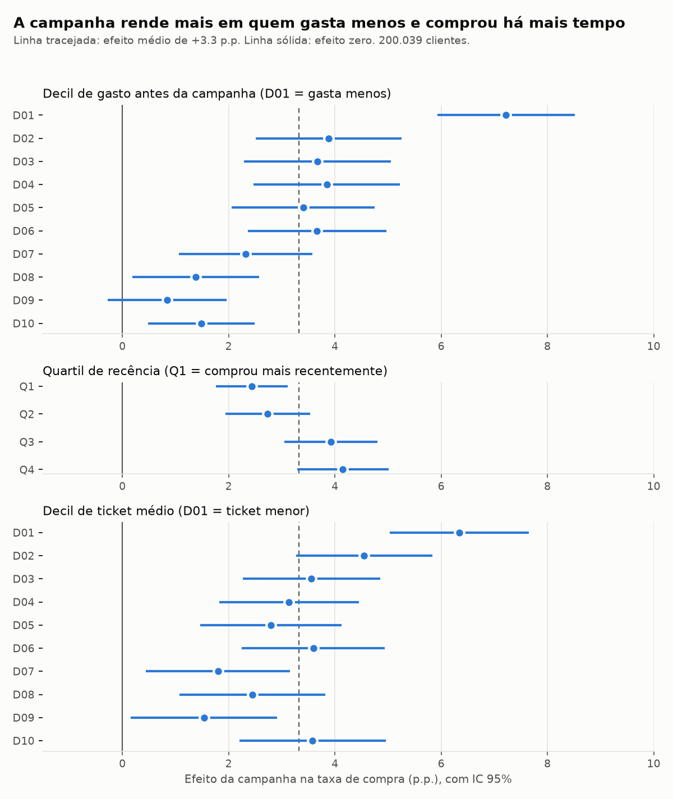

# Placar do experimento

Gerado por `persuadables placar` a partir de `sql/20_placar_experimento/`. Desfecho: `target`
(comprou depois da comunicação). Tratados: 99,981. Controle: 100,058.

## 1. O sorteio está são?

| checagem | resultado | leitura |
|---|---|---|
| proporção de tratados | 0.4998 | esperado 0,5 |
| qui-quadrado (SRM) | p = 0.863 | sem sinal de sorteio torto |
| maior \|SMD\| entre 36 variáveis | 0.0096 | tudo abaixo de 0,1: braços comparáveis |

## 2. Efeito médio

| | controle | tratamento | diferença |
|---|---:|---:|---:|
| taxa de compra | 60.33% | 63.65% | **+3.32 p.p.** |

- IC 95% analítico (Wald, no SQL): [2.90; 3.75] p.p.
- IC 95% por bootstrap (5.000 reamostras): [2.89; 3.74] p.p.
- p-valor: 5.8e-53
- Relativo: +5.5% sobre a taxa do controle.
- Em compras: cerca de **3,322 compradores a mais** entre
  99,981 tratados. Como 60% comprariam de qualquer jeito, cerca de
  95% das compras dos tratados não foram causadas pela campanha.

## 3. Redução de variância (CUPED)

| método | covariáveis | redução da variância | IC encolhe | efeito (p.p.) | IC 95% |
|---|---|---:|---:|---:|---|
| sem ajuste | - | - | - | 3.32 | [2.90; 3.75] |
| CUPED (SQL) | `dias_com_compra` | 14.6% | 7.6% | 3.21 | [2.82; 3.60] |
| CUPED por regressão | 10 do perfil | 19.5% | 10.3% | 3.26 | [2.88; 3.64] |

A redução da variância bate com ρ² da covariável (0.146), como a teoria prevê.
Ela é modesta porque o desfecho é binário: o histórico explica parte de quem compra, mas
longe de tudo. Em termos práticos, um IC 10% mais estreito
equivale a rodar o teste com cerca de 24% mais clientes.
A tabela completa por covariável está em `reports/20_placar_experimento/04_cuped.csv`.

## 4. Poder

- Com 99,981 por braço e taxa-base de 60.3%, o menor efeito detectável
  (α = 5%, poder 80%) é **0.61 p.p.** O efeito observado é cerca de
  5 vezes isso: o teste tinha folga.
- Num decil (cerca de 10 mil por braço) o MDE sobe para **1.94 p.p.**:
  diferenças entre segmentos menores que isso não são confiáveis.

## 5. Métrica de proteção

A base não tem gasto depois da campanha (ADR 0002), então não dá para medir se a campanha
derrubou o ticket. O que dá para ver é o efeito por faixa de ticket histórico: vai de
+1.5 p.p. (decil D09) a +6.3 p.p.
(decil D01). Num próximo teste, o
gasto pós-campanha precisa ser coletado como métrica de proteção definida antes do início.

## 6. Efeito por segmento

37 de 38 segmentos têm efeito diferente de zero depois
da correção de Benjamini-Hochberg (q < 5%). O mais útil é onde o efeito **muda**:

- **Gasto:** decil que menos gasta vs. decil que mais gasta: +5.7 p.p.
  (IC [4.1; 7.4], p = 7.1e-12).
- **Recência:** quartil que comprou há mais tempo vs. o mais recente: +1.7 p.p.
  (IC [0.6; 2.8], p = 2.1e-03).

Todo cliente do experimento comprou nos 23 dias anteriores ao corte, então não existe o
segmento "inativo há mais de 30 dias"; o recorte de recência usa 14 dias e quartis.

| segmento | nivel | n_t | n_c | efeito_pp | ic_inf_pp | ic_sup_pp | q_bh |
|---|---|---|---|---|---|---|---|
| decil_frequencia | D01 | 9,839 | 10,165 | 4.233 | 3.011 | 5.455 | 0 |
| decil_frequencia | D02 | 10,104 | 9,900 | 4.565 | 3.229 | 5.901 | 0 |
| decil_frequencia | D03 | 9,964 | 10,040 | 4.384 | 3.005 | 5.762 | 0 |
| decil_frequencia | D04 | 9,976 | 10,028 | 4.613 | 3.231 | 5.996 | 0 |
| decil_frequencia | D05 | 9,969 | 10,035 | 3.834 | 2.476 | 5.192 | 0 |
| decil_frequencia | D06 | 9,924 | 10,080 | 2.658 | 1.352 | 3.965 | 0 |
| decil_frequencia | D07 | 9,998 | 10,006 | 2.998 | 1.776 | 4.221 | 0 |
| decil_frequencia | D08 | 10,094 | 9,910 | 1.591 | 0.479 | 2.704 | 0.006 |
| decil_frequencia | D09 | 10,056 | 9,948 | 1.841 | 0.88 | 2.802 | 0 |
| decil_frequencia | D10 | 10,057 | 9,946 | 0.831 | 0.108 | 1.555 | 0.026 |
| decil_gasto | D01 | 9,903 | 10,101 | 7.219 | 5.926 | 8.512 | 0 |
| decil_gasto | D02 | 9,999 | 10,005 | 3.885 | 2.514 | 5.256 | 0 |
| decil_gasto | D03 | 9,887 | 10,117 | 3.674 | 2.289 | 5.059 | 0 |
| decil_gasto | D04 | 10,070 | 9,934 | 3.847 | 2.473 | 5.222 | 0 |
| decil_gasto | D05 | 9,914 | 10,090 | 3.406 | 2.059 | 4.752 | 0 |
| decil_gasto | D06 | 9,983 | 10,021 | 3.663 | 2.36 | 4.967 | 0 |
| decil_gasto | D07 | 10,058 | 9,946 | 2.324 | 1.067 | 3.581 | 0 |
| decil_gasto | D08 | 10,049 | 9,955 | 1.383 | 0.186 | 2.579 | 0.026 |
| decil_gasto | D09 | 10,022 | 9,982 | 0.841 | -0.275 | 1.958 | 0.14 |
| decil_gasto | D10 | 10,096 | 9,907 | 1.486 | 0.479 | 2.493 | 0.005 |
| decil_ticket | D01 | 10,020 | 9,984 | 6.34 | 5.033 | 7.646 | 0 |
| decil_ticket | D02 | 9,978 | 10,026 | 4.55 | 3.268 | 5.831 | 0 |
| decil_ticket | D03 | 10,002 | 10,002 | 3.559 | 2.262 | 4.856 | 0 |
| decil_ticket | D04 | 10,060 | 9,944 | 3.135 | 1.822 | 4.449 | 0 |
| decil_ticket | D05 | 9,912 | 10,092 | 2.795 | 1.462 | 4.127 | 0 |
| decil_ticket | D06 | 10,004 | 10,000 | 3.595 | 2.247 | 4.943 | 0 |
| decil_ticket | D07 | 9,878 | 10,126 | 1.798 | 0.439 | 3.158 | 0.011 |
| decil_ticket | D08 | 10,065 | 9,939 | 2.448 | 1.078 | 3.819 | 0.001 |
| decil_ticket | D09 | 9,966 | 10,038 | 1.539 | 0.162 | 2.916 | 0.029 |
| decil_ticket | D10 | 10,096 | 9,907 | 3.582 | 2.201 | 4.963 | 0 |
| fidelidade | já resgatou pontos | 80,053 | 79,840 | 3.136 | 2.669 | 3.604 | 0 |
| fidelidade | nunca resgatou | 19,928 | 20,218 | 3.859 | 2.881 | 4.836 | 0 |
| quartil_recencia | Q1 (1 = mais recente) | 25,015 | 24,995 | 2.438 | 1.761 | 3.115 | 0 |
| quartil_recencia | Q2 (1 = mais recente) | 24,933 | 25,077 | 2.737 | 1.944 | 3.531 | 0 |
| quartil_recencia | Q3 (1 = mais recente) | 25,109 | 24,901 | 3.924 | 3.052 | 4.796 | 0 |
| quartil_recencia | Q4 (1 = mais recente) | 24,924 | 25,085 | 4.151 | 3.292 | 5.01 | 0 |
| recencia_14d | comprou nos últimos 14 dias | 86,671 | 86,771 | 3.266 | 2.82 | 3.711 | 0 |
| recencia_14d | sem comprar há mais de 14 dias | 13,310 | 13,287 | 3.772 | 2.616 | 4.928 | 0 |
