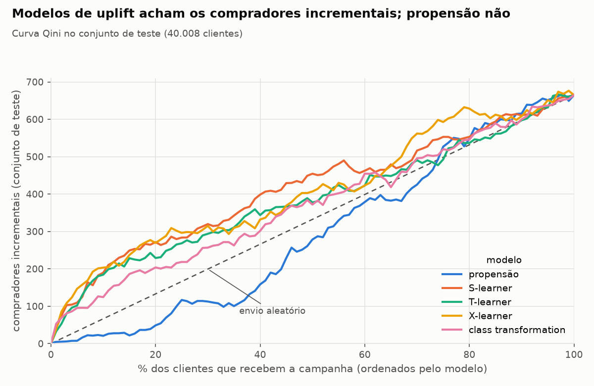

# Modelos de uplift

Gerado por `persuadables uplift`. Divisão estratificada por tratamento × desfecho, semente
42: treino 120,023, validação 40,008, teste 40,008. Todos os modelos usam
LightGBM com os mesmos hiperparâmetros e as variáveis do perfil em SQL. O modelo escolhido
é o de maior AUUC na **validação** (`S-learner`); os números abaixo são do
**teste**, que nenhum modelo viu.

## Placar dos modelos (teste)

| modelo | auuc | qini_auc | uplift_top10_pp | uplift_top30_pp | captura_top30 |
|---|---|---|---|---|---|
| S-learner | 0.0148 | 0.0094 | 9.5722 | 5.3706 | 0.4811 |
| X-learner | 0.0142 | 0.009 | 10.1479 | 5.2975 | 0.4738 |
| T-learner | 0.0096 | 0.0062 | 9.0978 | 4.9316 | 0.4419 |
| class transformation | 0.0069 | 0.0044 | 6.1957 | 4.3173 | 0.3862 |
| propensão | -0.007 | -0.0045 | 1.0356 | 1.8771 | 0.1692 |

- `auuc` e `qini_auc`: área sob a curva de uplift e sob a curva Qini, normalizadas pelo
  sklift (quanto maior, melhor; 0 = aleatório).
- `uplift_top30_pp`: diferença de taxa de compra entre tratados e controle dentro dos
  30% de maior score. Efeito médio no teste: 3.32 p.p.
- `captura_top30`: fração das compras incrementais da base inteira que já está nos 30%
  de maior score.

**Leitura:** o `S-learner` encontra nos 30% de maior score um efeito de
5.4 p.p., contra 1.9 p.p. nos 30% que a
propensão escolhe.

## Uplift observado por decil de score (teste)

Decil 1 = maior score. Se o modelo funciona, o uplift observado cai do decil 1 ao 10.

| decil | uplift `S-learner` (p.p.) | uplift propensão (p.p.) | taxa do controle, propensão |
|---|---:|---:|---:|
| 1 | +9.6 [6.5; 12.7] | +1.0 [-0.2; 2.2] | 96% |
| 2 | +4.1 [1.0; 7.2] | +1.4 [-0.5; 3.3] | 88% |
| 3 | +2.5 [-0.6; 5.5] | +2.9 [0.6; 5.3] | 81% |
| 4 | +3.7 [0.6; 6.8] | +2.3 [-0.4; 5.0] | 74% |
| 5 | +3.0 [-0.1; 6.0] | +6.5 [3.6; 9.5] | 63% |
| 6 | +0.3 [-2.6; 3.3] | +4.5 [1.4; 7.5] | 58% |
| 7 | +2.4 [-0.5; 5.3] | +2.8 [-0.3; 5.9] | 49% |
| 8 | +1.9 [-0.9; 4.7] | +6.3 [3.2; 9.3] | 40% |
| 9 | +1.9 [-0.7; 4.5] | +3.1 [0.1; 6.1] | 33% |
| 10 | +2.7 [-0.1; 5.5] | +2.0 [-0.6; 4.6] | 22% |

## Quem é influenciado

Mediana das variáveis do perfil nos 20% com maior uplift previsto pelo `S-learner`
contra os 20% com menor, no teste (valores em rublos):

| grupo | n | taxa_controle | uplift_observado_pp | ic_inf_pp | ic_sup_pp | gasto_total | ticket_medio | n_transacoes | dias_desde_ultima | gasto_30d | intervalo_medio_dias | ja_resgatou | prop_transacoes_com_resgate | lojas_distintas | idade |
|---|---|---|---|---|---|---|---|---|---|---|---|---|---|---|---|
| 20% maior uplift | 8,001 | 0.46 | 6.85 | 4.66 | 9.04 | 2,830 | 290.15 | 9 | 7.38 | 765 | 9.25 | 1 | 0.07 | 2 | 58 |
| 20% menor uplift | 8,001 | 0.73 | 2.4 | 0.49 | 4.31 | 13,129.71 | 444.58 | 32 | 2.5 | 3,513.39 | 3.28 | 1 | 0.03 | 3 | 40 |
| todos | 40,008 | 0.6 | 3.32 | 2.37 | 4.27 | 6,110.61 | 394.85 | 15 | 4.42 | 1,804 | 6.17 | 1 | 0.04 | 2 | 45 |

Nos 20% de maior uplift a campanha mudou a compra em +6.9 p.p.
(IC [4.7; 9.0]); nos 20% de menor, em
+2.4 p.p. (IC [0.5; 4.3]).
Mediana dos mais influenciados contra os menos: 9 contra
32 transações, 2,830 contra
13,130 rublos gastos no período, 7.4 contra
2.5 dias desde a última compra, idade de 58
contra 40 anos. Sem a campanha,
46% deles comprariam, contra 73% no grupo
de menor uplift.
